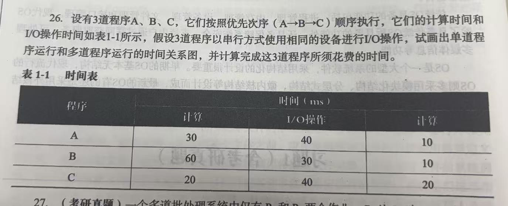
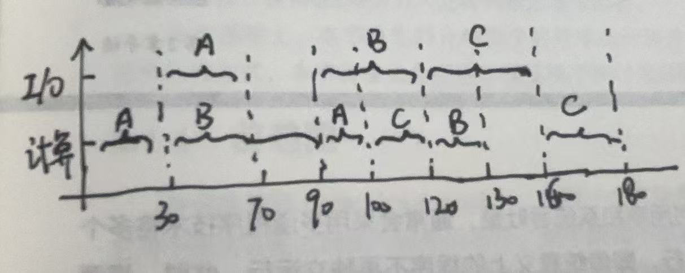
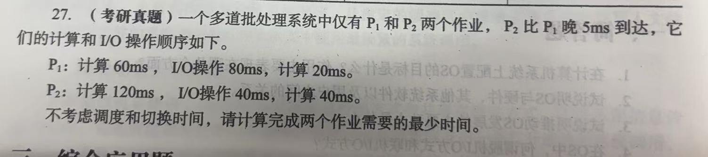
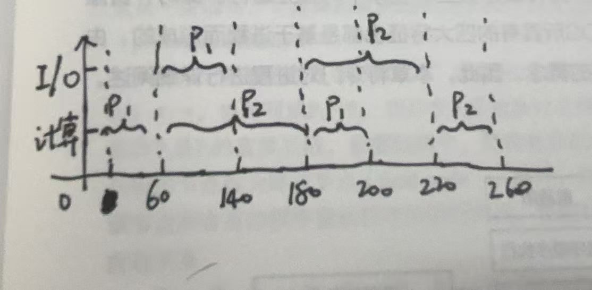
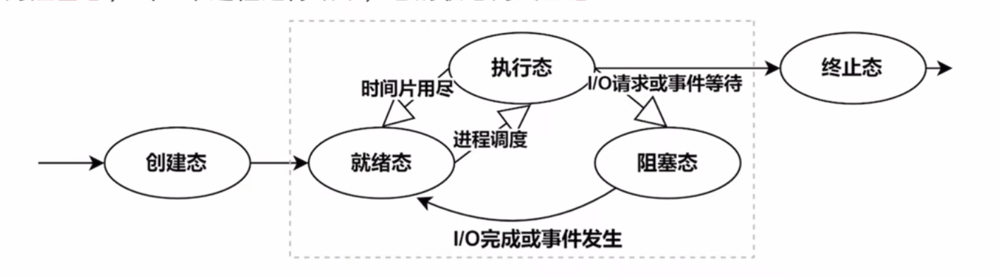

# 1.0 操作系统引论

## 1.1 操作系统发展过程
### 1.1.1 单道批处理系统

**缺点：** 系统中资源得不到充分利用。

### 1.1.2 多道批处理系统

**重点：**
 - 主要是为了提高资源利用率和系统吞吐量
 - 无交互性 （引出分时系统）

**优点：**
 1. 资源利用率高
 2. 系统吞吐量大

**缺点：**
 1. 无交互性
 2. 平均周转长

### 1.1.3 分时系统

**重点：** 满足人机交互需求

特征： 
 1. **多路性：** 允许多个用户共享一台计算机。
 2. **独立性：** 允许每个用户再各自终端操作，彼此之间互不干扰，给用户感觉像是一人独占一台主机。
 3. **及时性：** 用户的请求在很短时间内获得响应。
 4. **交互性：** 用户可以使用终端与系统进行人机交互

### 1.1.4 实时系统

**重点：** 在规定时间做出处理

**重点特性：**
 1. 实时性
 2. 可靠性

**例子：**
 1. 火箭发射控制系统
 2. 核电站控制和监控系统

## 1.2 操作系统基本特征
操作系统的基本特征：
 1. 并发
 2. 共享
 3. 虚拟
 4. 异步

### 1.2.1 并发

**并发和并行的区别：** 区别主要在时间上
  1. 并发：同一时间间隔段内
  2. 并行：同一时刻

**举个例子：**
- 比如你在**今年**交往了**两个**对象，但是你一天只能陪一个对象，1号陪A，2号陪B，三号陪A，4号陪B...在这一年时间间隔里面，你交替着陪两个对象，这就是**并发**
- 但是如果你掌握了制衡，你可以做到三个人在一块把日子过好，一天的同一时刻同时陪着两个对象，这就是**并行**

### 1.2.2 共享
1. 互斥共享：一段时间只允许一个进程访问资源
2. 同时共享：一段时间允许多个进程同时访问

### 1.2.3 虚拟
**重点：** 
 使用虚拟技术“增强”或“增加”资源的能力或数量
（但真实的能力和数量没有变化）

### 1.2.4 异步
**重点：** 
 多个程序环境下，系统允许多个进程并发执行。

## 1.3 操作系统运行环境

### 1.3.1 操作系统内核
**重点：** 
1. 操作系统内核时计算机上配置的底层软件。
2. 内核通常由一些与**硬件紧密相关、运行频率较高的程序**共同**构成**（包含时钟管理、中断处理、设备驱动、进程管理、存储器管理）

大多操作系统内核包含一下两种功能： 
1. **支撑功能： **
该类功能主要实现提供给操作系统其他众多模块所需要的一些基本功能，以支撑这些模块工作。
 - **中断处理：** 中断处理是内核最基本的功能
 - **时钟管理：** 时间管理是内核的一项基本功能
 - **原语操作：** 原语是由若干指令组成的，用于完成一定功能的一个过程。（原子操作：要么全做，要么全不做）

2. **资源管理： **
- **进程管理**
- **存储器管理**
- **设备管理**

## 1.4 处理机的双重工作模式

### 1.4.1 处理机的两种单独运行模式
**重点：**   
**用户态（目态）** 和 **内核态（管态或系统态）** 
计算机硬件可以通过一个**模式位** 来表示当前模式：**内核态（0）** 和**用户态（1）** 

### 1.4.2 两种指令
1. **特权指令：** 在内核态下运行的指令
2. **非特权指令：** 在用户态下运行的指令

**重点：** 特权指令是只有操作系统才有权使用的指令 
1. 改变机器状态指令
2. 修改特殊寄存器指令
3. 涉及外部设备输入输出指令

### 1.4.3 中断与异常

中断： 程序执行过程中，若外设或发生某些特殊事件，外设向CPU发出中断请求，要求CPU处理这些情况。 
（例如键盘缓冲区已满，打印机没纸）

异常： 处理器在其内部检测到的、与正在执行的指令的相关事件 

## 第一章 习题
1. 什么是用户态和内核态？用户态和内核态是如何切换的？ 
答案：用户态只能执行非特权指令，访问自己的用户空间；内核态可以执行所有指令，访问所有资源；用户态转换到内核态，通过中断、异常或陷入；内核态转换到用户态，通过中断返回。

2. 与宏内核OS相比，微内核OS具有哪些优点和不足？ 
答案：微内核的扩展性好，可靠性高，可移植性好；缺点是性能不如宏内核。

3. 执行系统调用的过程包括：1.返回用户态；2.执行陷入（trap）指令；3.传递系统调用参数；4.执行相应的服务程序。请问执行顺序是什么？ 
答案：3.传递系统调用参数，2.执行陷入指令，4.执行响应的服务程序，1.返回用户态。

4. 

答案：单道：按照A，B，C的顺序，（30+40+10）+（60+30+10）+（20+40+20）=260ms 
多道：

5. 

答案：

# 2.0 进程的描述与控制

## 2.1 进程的定义

进程是一个为了更好对并发执行的程序加以描述和控制而创造出来的概念。

PCB（进程块）: 操作系统为每个进程建立的一个数据结构，系统用PCB来描述进程的基本情况和活动过程，进而控制和管理进程。

## 2.2 进程的基本状态和转换

### 2.2.1 创建状态和终止状态
1. 创建装态：申请空白PCB，系统为该进程分配资源

2. 终止状态：系统回收资源，销毁PCB

### 2.2.2 进程三种基本状态

1. 就绪状态：进程已经准备好的状态，即进程已分配到除CPU以外的所有必要资源。**等待到CPU后，就可以执行）**

2. 执行状态：进程获取到CPU，正在执行当中的状态。**“处于执行状态”的进程数必须小于或等于CPU数**

3. 阻塞状态：正在执行的进程由于发生某事件（等待输入、I/O请求等）而暂时无法继续执行。**拥有CPU，但是无法执行**

**注意：** 阻塞态无法直接转换为执行态，而是先要转换为就绪态。  
**例子：** 一个“根据输入年龄，判断出生年份的程序”写好之后，点击运行，如有其他程序在执行，那这个程序的进程先变成**就绪态**，等待CPU。然后轮到这个程序执行，转换为**执行态**，然后程序需要等待用户输入年龄，进入**阻塞态**，输入完毕之后，转换为**就绪态**，然后再转为**执行态**

### 2.2.3 进程的状态转换

## 2.3 线程

### 2.3.1 线程的引入

目的：为了让同个进程的各个函数之间并发运行。

线程——作为调度和分派的基本单位
调度——分配CPU
多个线程共享同个进程的资源

### 2.3.2 线程状态和线程控制块

#### 线程状态
线程和进程一样，具有执行的三个状态 
 
 1. 执行状态：线程已获取CPU正在执行。
 2. 就绪状态：线程具备各种执行条件，只需等到到CPU即可执行
 3. 阻塞状态：线程执行中因某件事件而受阻。 

#### 线程控制块（TCB）
如同每个进程有一个PCB一样，系统也为每个线程配置了一个TCB，将所有用于控制和管理线程的信息记录在TCB中。

### 2.3.3 线程的实现

线程在各系统的实现方式并不完全相同，比如在一些数据库管理系统中，所实现的是用户级线程；在linux、macOS等实现的是内核支持线程；此外还有些系统，实现的是两种线程的组合。

#### 内核支持线程（KST）

优点：发生阻塞时，可以切换为其他线程。 
缺点：切换开销大。

#### 用户机线程（ULT）

优点：切换开销小。 
缺点：一旦发生阻塞，整个进程都需要阻塞。

## 第二章 习题
1. OS中为什么要引入进程？它会产生什么影响？ 
答案：程序是静态的，并发执行时失去封闭性和可再现性，需要引入进程来描述和控制程序；提高并发，实现资源利用率

2. 如何理解进程的顺序性和并发性？ 
答案：进程内的指令按照顺序依次执行；多个进程同一时间间隔内都在执行。

